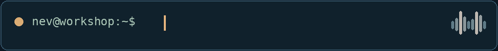
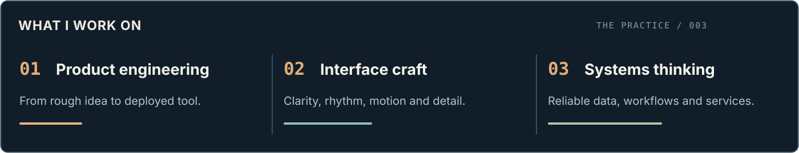
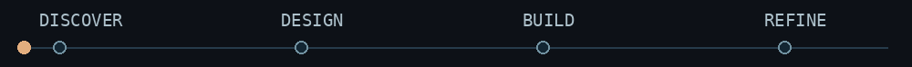
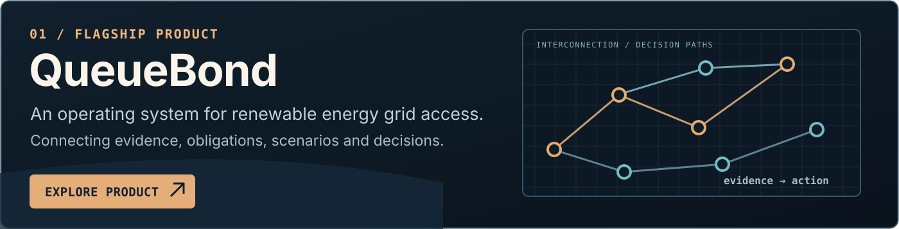
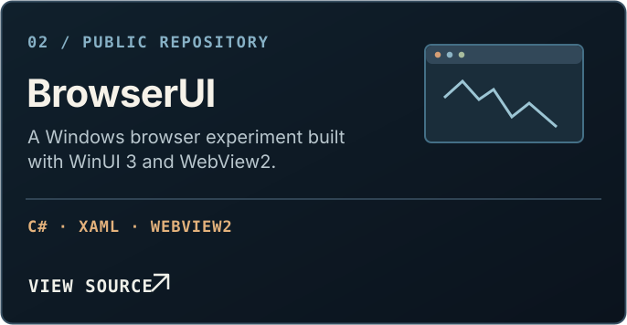
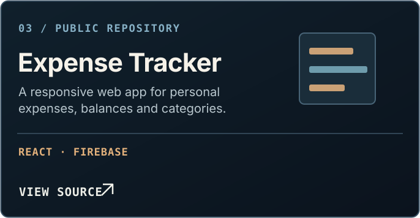

<!-- Nevil Biju · GitHub profile README. All visual assets are local. -->

  

 

  &nbsp;
  &nbsp;
  &nbsp;
  &nbsp;
  

 

 

 

### Software should feel considered, not just completed.

I'm **Nevil**, a software and web developer from Kerala, India. I enjoy working across the whole product, from defining the problem and shaping an interface to building the system behind it. I care about products that are useful, fast, and pleasant to use.

 

  &nbsp;
  

<a href="https://github.com/JOSU10xD?tab=repositories&type=public"><strong>Explore more public repositories ↗</strong></a>

### Tools I reach for

**Web and product** &nbsp; `JavaScript` `TypeScript` `React` `Next.js` `Node.js`  
**Data and cloud** &nbsp; `Firebase` `Supabase` `PostgreSQL` `MySQL` `AWS`  
**Other things I build with** &nbsp; `Python` `Java` `C#` `.NET` `WinUI 3` `Linux`

### A little about how I work

I like simple interfaces with depth beneath them, thoughtful details over unnecessary decoration, and learning by shipping real things. My interests span product design, developer tools, full-stack systems, and early-stage ideas.

**Want to see the work rather than just read about it?** [Open my portfolio](https://josu10xd.github.io/josu-portfolio/) or [explore QueueBond](https://queuebond.online/).

